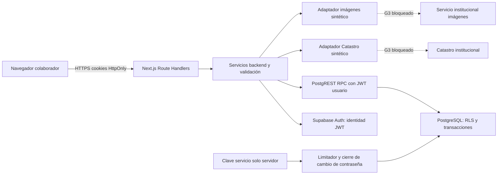
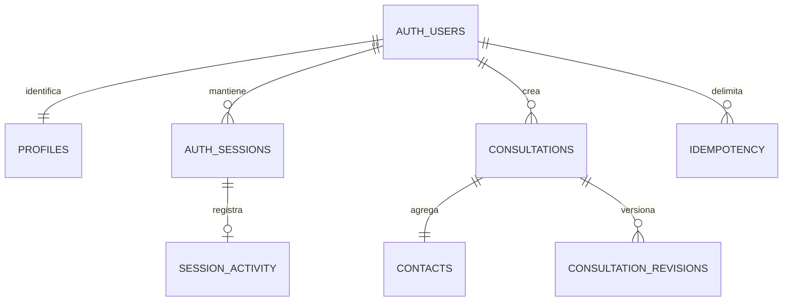

# Arquitectura, límites y superficie de ataque — PAY-T010/T015

Estado: implementación local sintética; cloud, identidad real y G3 sin validar. Esta documentación no acredita despliegue ni conectividad institucional.

El navegador no es frontera de autorización. El backend verifica identidad, perfil y sesión; PostgreSQL vuelve a verificar permisos en RLS/RPC para cubrir llamadas directas a PostgREST. Las acciones privilegiadas se limitan a dos RPC concretos; no se usa service-role para consultas de negocio. El dominio no depende de Vercel. Los adaptadores remotos todavía requieren contratos y red autorizada.

| Entrada o límite | Control implementado/local | Validación o riesgo pendiente |
|---|---|---|
| Login y recuperación | Identificador visible asociado en servidor; errores genéricos; limitador persistente | Configurar Auth nativo, CAPTCHA y recuperación; intento directo a Auth no pasa por limitador API |
| Cookies y escritura API | HttpOnly, verificación Origin, límite JSON, respuestas no-store | HTTPS, cookies y proxy confiable del hosting real |
| JWT hacia base | UID/session_id, perfil habilitado, actividad, contraseña y ownership en base | JWT reales, GoTrue, expiración/refresh y revocación cloud |
| Consultas/contactos | Validación, RPC atómico, versiones, idempotencia y snapshot | Concurrencia multi-conexión y volumen institucional |
| Búsquedas e imágenes | Fixtures sintéticos, fechas y expiración de imágenes | Contrato institucional, permisos, URLs privadas y capacidad |
| Logs | Metadatos mínimos sin cuerpos ni query | Retención, alertas y acceso a logs del hosting |
| Cadena de suministro | Versiones exactas, lockfile, inventario y revisión | Licencias UNKNOWN, advisories actualizados y CI autorizado |
| Secretos | Variables servidor, ejemplo sin valores, gitignore | Canal seguro, rotación, custodio y configuración por entorno |

No se implementan endpoints institucionales ficticios ni se usa información real. Una imagen histórica no implica permiso de redistribución: debe resolverse en el contrato de imágenes. Los logs tampoco pueden convertirse en repositorio de datos personales.

## Modelo relacional

`locality + parcel` es una referencia externa lógica, no una FK a Catastro cloud. Cada consulta crea un contacto nuevo y una copia histórica; la edición no sobrescribe esos datos. Los nombres del diagrama describen entidades; consultar la migración para nombres físicos y restricciones exactas. Login attempts es almacenamiento privado independiente con hash SHA-256 del nombre normalizado, sin IP/correo en claro. El hash permite ataques de diccionario y no constituye anonimización fuerte; no hay limitador por IP implementado.

## Migraciones y reversión segura

La migración inicial se genera con el CLI local fijado, usando `SUPABASE_HOME="$PWD/.supabase"` para no escribir configuración global. Antes de aplicar a cualquier destino: identificar proyecto y versión, revisar diff y grants, confirmar aislamiento, ejecutar en destino descartable y guardar evidencia. Ninguna migración se aplicó a cloud.

No hay script de rollback con DROP: eliminar tablas borraría consultas. Preferir corrección forward-only y releases compatibles. Ante incidente, detener escrituras, preservar evidencia, restaurar backup probado en un destino nuevo autorizado y validar antes de cambiar conexiones. Un rollback de frontend no revierte datos ni Auth. Backup/restore real, RPO/RTO y aceptación siguen pendientes; ver operations.md.
